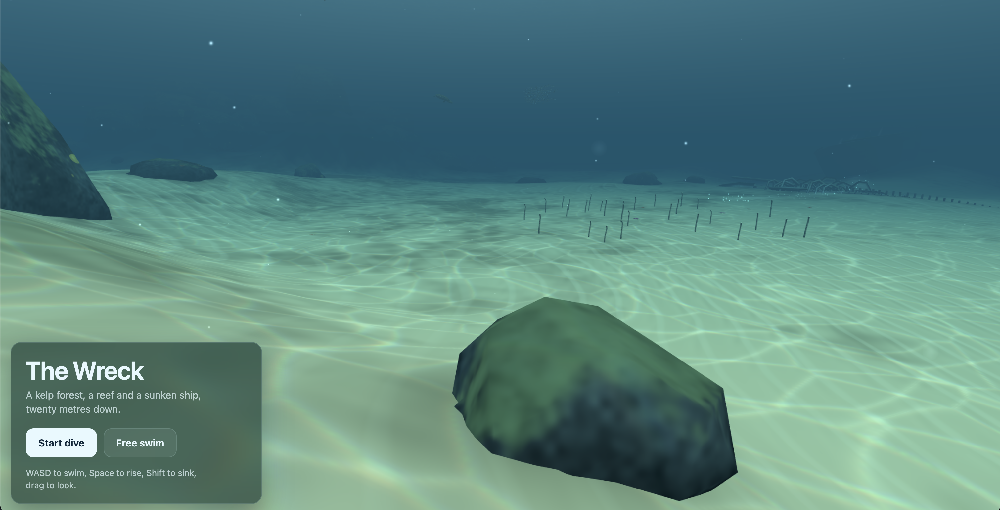
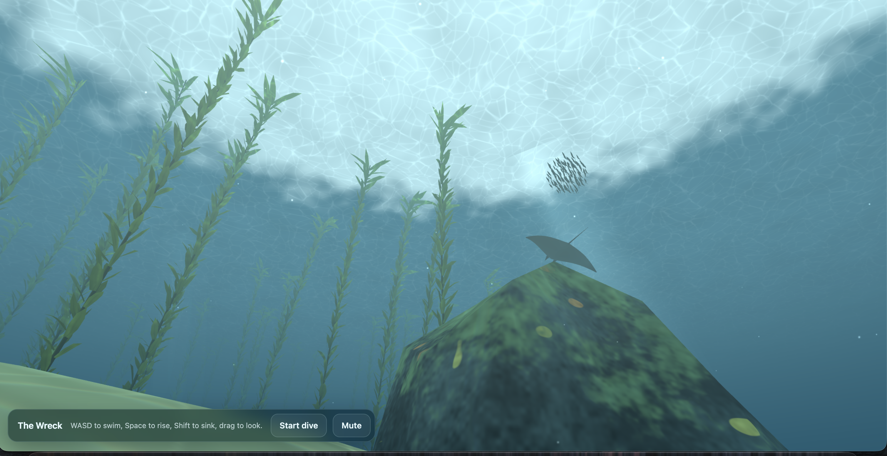
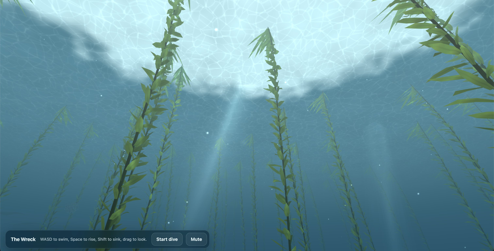

# The Wreck

A procedural 3D underwater world in a single `index.html`: a kelp forest, a rocky reef, a sand
clearing, a half-buried whale skeleton and a sunken sailing ship at the end of a glowing trail,
with ten kinds of sea life, Web Audio ambience and a 30-second guided dive.

Everything — geometry, textures, caustics, sound — is generated in code with Three.js (r170,
loaded from a CDN). There are no asset files.

**Live:** https://underwater-sea-world.vercel.app



| | |
|---|---|
|  |  |
| Kelp, a sardine bait ball and a manta under Snell's window | Inside the kelp forest, looking toward the surface |

## Run it

Serve the folder with any static server and open `index.html`, for example:

```sh
python3 -m http.server 8000
# then open http://localhost:8000
```

## Controls

| Input | Action |
|---|---|
| W A S D | Swim where you look |
| Space / Shift or C | Rise / sink |
| Mouse drag | Look |
| Touch | Left half: joystick · right half: drag to look |
| Tap, click or Esc | Skip the tour |

## URL parameters

| Parameter | Effect |
|---|---|
| `?debug=1` | FPS, draw calls, triangles, quality tier, camera position |
| `?shot=kelp\|reef\|clearing\|ship\|skeleton\|surface` | Fixed camera preset for screenshots |
| `?q=low\|high` | Force a quality tier |
| `?tour=1` | Start the guided dive immediately (no audio) |
| `?cam=x,y,z,tx,ty,tz` | Place the camera (debug) |
| `?focus=<animal>&fd=<distance>` | Follow a creature (debug): `school`, `manta`, `turtle`, `yellow`, `blue`, `jelly`, `eel`, `grouper`, `star`, `urchin` |

## Code structure

```
UnderwaterSeaWorld/
├── index.html       the whole experience (HTML, CSS, JS and GLSL inline)
├── Pictures/        screenshots used in this README
├── README.md
├── Prompt.md        the build brief
└── CHECKPOINTS.md   phase-by-phase build log with measurements
```

`index.html` is split into commented sections, in this order:

| Section | What it holds |
|---|---|
| `CONFIG` | Every colour and tunable number |
| `QUALITY` | Starting quality tier, renderer setup, runtime adaptation |
| `NOISE / UTILS` | Seeded noise, the heightfield and its zones, geometry helpers |
| `SHADER CHUNKS` | Shared GLSL: water absorption and fog, caustics, lighting |
| `ENVIRONMENT` | Background, seabed, rocks, coral, sea fans, anemones, kelp, sun rays, surface, particles |
| `LOCATIONS` | The wreck, whale skeleton, glow path, level of detail, contact-shadow map |
| `CREATURES` | The ten animals and their motion |
| `CONTROLS` | Free-swim input (keyboard, mouse, touch) and collision |
| `TOUR` | The 30-second guided dive |
| `AUDIO` | Web Audio ambience |
| `UI` | Overlay, debug readout, camera presets, resize |
| `LOOP` | Per-frame update and render |
